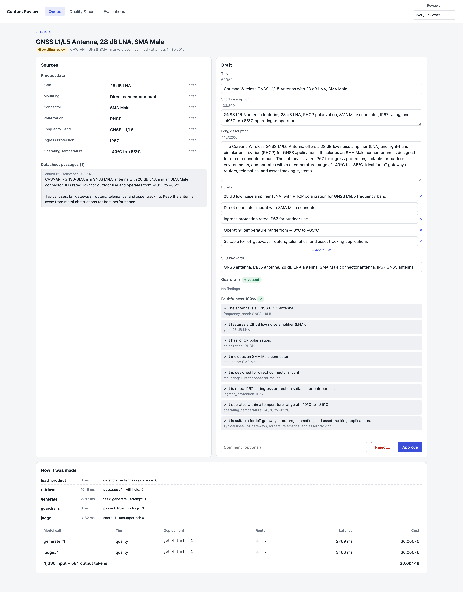

# electronics-ai-content-engine

An agentic GenAI engine that writes product content for an electronics catalog (connectors, cable assemblies,
antennas, network cables), grounded in product data and datasheets, checked by guardrails and an LLM judge, and
approved by a human before it is saved. Built with Python, FastAPI, LangGraph, MCP and Azure OpenAI.

> Independent portfolio project. The catalog, brands and SKUs are fictional.

## Architecture

```
 reviewer / API client
        │  POST /api/jobs  (scoped bearer token)
        ▼
 content-engine (FastAPI + LangGraph) ── queue: Redis Streams locally / Azure Service Bus in Azure
   load_product → retrieve → generate → guardrails → judge → human review → save draft
        │ MCP (streamable HTTP, scoped tokens)          │ HTTPS (virtual key)
        ▼                                               ▼
 catalog-mcp (MCP server)                         llm-gateway (FastAPI)
   search_products, get_product,                    routing by task (fast / quality tier, fallback),
   search_datasheet (hybrid RAG: pgvector + full-     per-app keys, budgets, rate limits, PII redaction,
   text, reciprocal rank fusion), save_draft          response cache, usage and cost ledger
        │                                               │
        ▼                                               ▼
 PostgreSQL + pgvector                            Azure OpenAI (gpt-4.1-mini, text-embedding-3-small)

 OpenTelemetry traces from every service → Arize Phoenix
```

## What it demonstrates

| Area | How |
|---|---|
| Agent workflow | LangGraph state machine with retries driven by validation feedback; the model never chooses tool calls, so poisoned content can't trigger actions |
| Tool integration | MCP server with least-privilege scopes: `catalog:read` for everyone, `drafts:write` only for the engine, and no tool can change product master data |
| LLM gateway | Task-based routing (quality tier for first drafts and judging, fast tier for small fixes and tight latency budgets), fallback on throttling, per-app virtual keys and monthly budgets, cost attributed per feature |
| Grounding | Hybrid retrieval over datasheets; every number and unit in the copy must appear in the source data |
| Guardrails | Strict structured output (Pydantic), channel rules, forbidden claims, PII detection and redaction, instruction-leak checks, Azure content-filter handling |
| Prompt-injection defense | Supplier text is delimited and treated as untrusted data; chunks with injected instructions are withheld before generation (one demo datasheet is deliberately poisoned) |
| Evaluation | LLM-as-judge faithfulness scoring per draft; judge-only objections go to a human, flagged, because judges make mistakes too |
| Human in the loop | Approve, edit or reject with a reason; rejection comments become guidance for future drafts in that product category |
| Operations | Idempotent queue consumers, at-least-once delivery, OpenTelemetry traces, passwordless Azure auth (Managed Identity) in the code paths |

## Run it locally

Requires Docker and [uv](https://docs.astral.sh/uv/).

```bash
./scripts/init-env.sh          # random local secrets into .env (never printed)
docker compose up -d --build   # postgres+pgvector, redis, phoenix, gateway, catalog MCP, engine
uv sync && make test           # unit tests
uv run --no-sync python scripts/smoke.py   # end-to-end checks against the running stack
```

It runs with a deterministic mock model by default (`LLM_PROVIDER=mock`). To use Azure OpenAI, deploy a chat model
and `text-embedding-3-small` in Azure AI Foundry, then set `LLM_PROVIDER=azure`, the endpoint, key and deployment
names in `.env`. The catalog re-embeds automatically when the embedding model changes.

| URL | |
|---|---|
| http://localhost:8002/docs | Content engine API |
| http://localhost:8000/docs | LLM gateway API |
| http://localhost:6006 | Phoenix traces |

## Review UI

`http://localhost:5173`: a queue of drafts by status; a review screen with the product data and datasheet passages
next to the editable draft, guardrail findings, the judge's claim-by-claim verdict, and every model call with its
tier and cost; approve, edit-and-approve or reject with a reason (which becomes guidance for future drafts); a quality
and cost dashboard from the gateway ledger; and the latest evaluation report. The browser never holds an API token:
the web server adds it when proxying `/api`.



## Evaluation

`make eval` runs `evals/gold.jsonl` (12 cases across all product categories, both channels, and a poisoned
datasheet) through the real pipeline and scores it, mostly deterministically: structured-output validity,
guardrail pass rate, spec accuracy (every number in the copy exists in the source), required facts mentioned,
forbidden claims, injection blocked, plus LLM-judge faithfulness, cost and p95 latency. `evals/thresholds.json`
holds the regression gates; a failed gate exits non-zero.

Latest run on Azure OpenAI (gpt-4.1-mini): all 9 gates passed, 12/12 first-attempt success, 100% spec accuracy and
required facts, no forbidden claims, injection blocked, $0.0018 per product, p95 8.4 s.

## CI/CD and Azure

- `ci.yml` (every PR): ruff, unit tests, web build, Bicep build and lint, and the full Docker stack with the mock
  model plus the end-to-end smoke test.
- `eval.yml` (manual): the gold-set evaluation against Azure OpenAI; uploads the report; fails on regressions.
- `deploy.yml` (manual): keyless OIDC login, images built in ACR, Bicep deployment.
- `infra/azure/main.bicep`: Container Apps with a managed identity per service, Key Vault references, PostgreSQL
  with pgvector, Service Bus, and passwordless access to Azure OpenAI. See [infra/azure/README.md](infra/azure/README.md).
